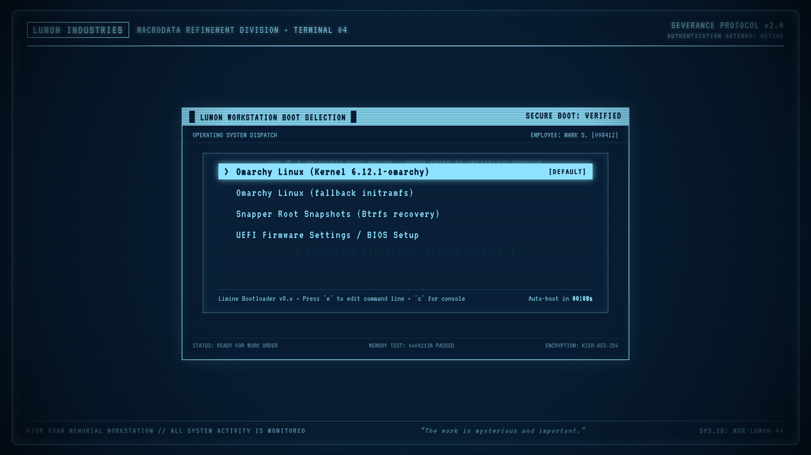

# Lumon Industries Limine Bootloader Theme

A cold corporate Limine bootloader theme inspired by Lumon Industries and the terminal aesthetic of *Severance*. Featuring the signature Lumon CRT display, scanlines, phosphor glow, Kier Egan status telemetry, and fluorescent cyan palettes.



## Features

- **CRT Terminal Framing**: Custom 1920x1080 wallpaper engineered to frame Limine's boot selection menu seamlessly inside the Lumon CRT terminal display.
- **Severance Color Palette**: Lumon Navy (`#09213A`) and Fluorescent Cyan (`#8FE2FF`) coordinated terminal palette and branding.
- **Two Wallpaper Variants**:
  - `default`: Lumon Terminal framed stage with Severance header & Kier Egan memorial footer.
  - `login`: Exact replica render of the Lumon Macrodata Refinement login console.
- **Safe Installer**: Automatically creates timestamped backups of `limine.conf`, manages marked theme blocks, and supports `limine-enroll-config` for Secure Boot / integrity-checked systems.
- **Zero Distractions**: Clean, legible, high-contrast boot menu experience.

## Installation

To install on Arch Linux, Omarchy, CachyOS, or any Linux system using the Limine bootloader:

```bash
cd lumon-limine-theme
sudo ./install.sh
```

### Install with Alternative Wallpaper Variant

If you prefer the full login screen screenshot variant:

```bash
sudo ./install.sh --variant login
```

### Dry Run Test

To test without applying changes to `/boot`:

```bash
sudo ./install.sh --dry-run
```

## Uninstallation

To restore your previous Limine bootloader configuration:

```bash
sudo ./uninstall.sh
```

## Configuration Reference (`theme.conf`)

```ini
interface_resolution: 1920x1080
interface_branding: "LUMON INDUSTRIES // MACRODATA REFINEMENT DIVISION"
interface_branding_color: 8fe2ff
interface_help_color: 51869e
interface_help_color_bright: 8fe2ff
interface_help_hidden: no
wallpaper: boot():/lumon-limine-theme/wallpaper.png
wallpaper_style: stretched
term_margin: 240
term_margin_gradient: 16
term_background: 9909213a
term_background_bright: 1f4068
term_foreground: 8fe2ff
term_foreground_bright: c7f3ff
term_palette: 09213a;e06c75;98c379;e5c07b;61afef;c678dd;8fe2ff;abb2bf
term_palette_bright: 1e3a5f;ff7b86;b2e596;f6d68d;7dc5fd;db8aef;c7f3ff;ffffff
timeout: 10
default_entry: 1
remember_last_entry: yes
```

---
*Please enjoy each boot equally.*
